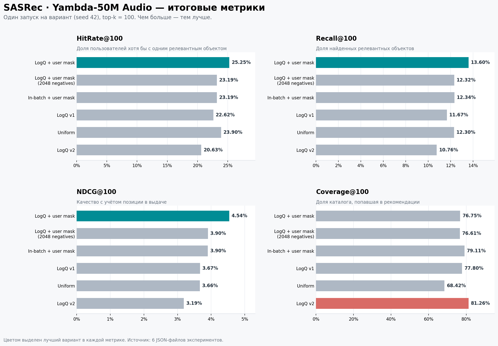
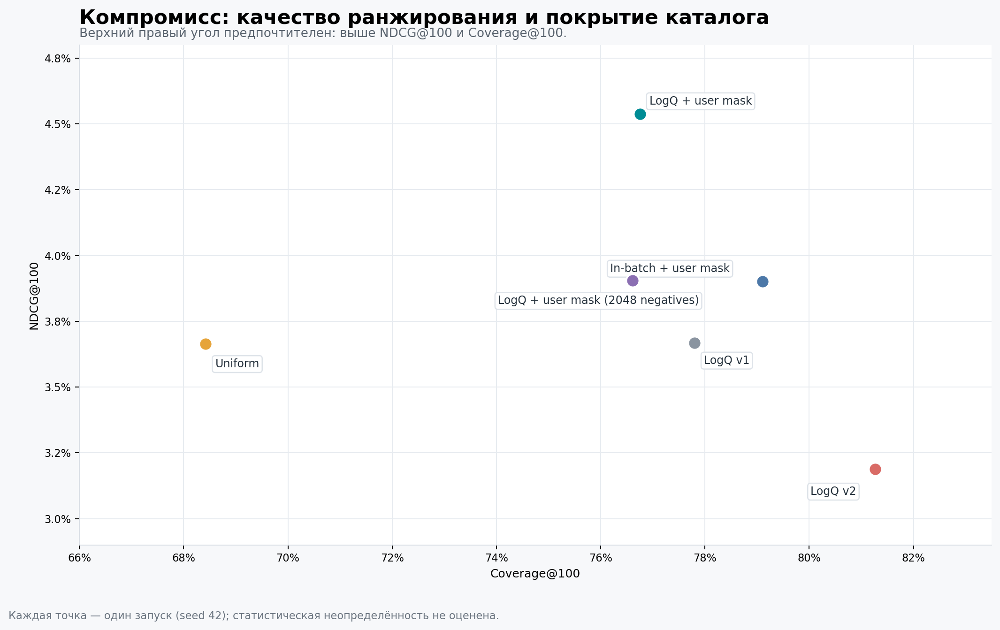
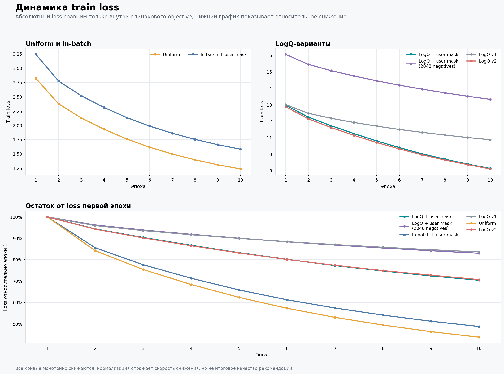

# SASRec baseline on Yambda-50M

## Experiment status

The first full Yambda-50M SASRec run was completed on 2026-07-26. This
configuration is named **SASRec-Audio-Uniform**:

- SASRec uses ordinary item ids and does not use Semantic IDs;
- the item embedding table is initialized with trainable, L2-normalized audio
  embeddings;
- training uses uniformly sampled negatives without in-batch negatives or
  LogQ correction.

This result is the control point for a follow-up
**SASRec-Audio-LogQ** experiment. It is a baseline with respect to Semantic IDs
and LogQ, but it is not a pure randomly initialized ID-only SASRec baseline.

## Dataset and preprocessing

The interaction source is the official Yambda-50M likes split:

```text
Hugging Face repository: yandex/yambda
file: flat/50m/likes.parquet
```

The shared preprocessing:

- restricts interactions to items covered by the audio-embedding catalog;
- keeps items with at least 5 interactions;
- maps retained item ids once to the dense range `[0, catalog_size)`;
- sorts interactions chronologically;
- uses the final 7 days as the test interval and all earlier interactions as
  training data.

Training examples are next-item prefixes truncated to the final 100 events.
Evaluation uses the final available training history for each user with at
least one event in the test interval.

The prepared dataset used for the run contained:

| Data statistic | Value |
| --- | ---: |
| Interactions | 634,642 |
| Users | 8,032 |
| Catalog items | 33,148 |
| Train interactions | 630,095 |
| Test interactions | 4,547 |

## Model and training configuration

| Parameter | Value |
| --- | ---: |
| Item embedding initialization | L2-normalized audio vectors |
| Item embeddings trainable | Yes |
| Embedding dimension | 128 |
| Maximum sequence length | 100 |
| Transformer layers | 2 |
| Attention heads | 2 |
| Dropout | 0.1 |
| Batch size | 128 |
| Epochs | 10 |
| Optimizer | AdamW |
| Learning rate | 0.001 |
| Weight decay | 0 |
| Negatives per example | 100 |
| Negative sampling | Uniform, excluding the target |
| In-batch negatives | No |
| LogQ correction | No |
| Evaluation cutoff | 100 |
| Evaluation item chunk size | 20,000 |
| Seed | 42 |

The model uses a causal Transformer encoder and a shared input/output item
embedding table. Training applies cross-entropy to one positive and 100 sampled
negative logits per example. Evaluation computes exact top-100 recommendations
over the eligible catalog in chunks.

## Run command

The experiment was launched from the repository root:

```bash
python run.py \
  --source-embeddings ~/projects/sids_rank_vs_generate/embeddings.parquet \
  --epochs 10 \
  --batch-size 128 \
  --device cuda \
  --metrics-json reports/experiments/sasrec_yambda_50m.json
```

The source embedding path is needed only when preparing the compact
Yambda-50M embedding cache for the first time. Later runs reuse the cache.

### Pretrained-history concatenation control

The requested SASRec control is available with:

```bash
sasrec-baseline \
  --pretrained-embedding-mode history-concat \
  --epochs 10 \
  --metrics-json reports/experiments/sasrec/metrics/sasrec_yambda_50m_audio_history_concat_seed42.json
```

In this mode the learned item-id embedding and the frozen normalized audio
embedding are concatenated for every history position. A linear projection maps
the concatenation back to the configured SASRec dimension. The output item
table remains the learned item-id table, so this is a distinct baseline from
the existing audio-initialized run. The full Yambda-50M run completed on a
Tesla V100 with seed 42:

| Configuration | Recall@100 | HitRate@100 | NDCG@100 | Coverage@100 |
| --- | ---: | ---: | ---: | ---: |
| [SASRec history-concat](sasrec/metrics/sasrec_yambda_50m_audio_history_concat_seed42.json) | **0.1281415231** | **0.2421652422** | **0.0387329381** | 0.6169301315 |

Relative to SASRec-Audio-Uniform, history-concat improves Recall@100 by 4.16%,
HitRate@100 by 1.34%, and NDCG@100 by 5.71%, while reducing Coverage@100 by
9.84%.

## Full-run results

All metrics use a cutoff of 100.

| Metric | Value |
| --- | ---: |
| HitRate@100 | 0.2389758179 |
| Recall@100 | 0.1230292144 |
| NDCG@100 | 0.0366398676 |
| Coverage@100 | 0.6842343429 |

The run exceeds the homework Recall@100 reference value of `0.11`. Coverage is
high, while HitRate and NDCG leave room for improving the ordering of relevant
items. The raw generated JSON also contains the per-epoch training losses and
the complete serialized configuration.

## Run environment

- Date: 2026-07-26
- Branch: `SASRec`
- Commit: `e6e6e49` (`Support FP16 training on V100`)
- Device: NVIDIA Tesla V100-PCIE-32GB
- NVIDIA driver: 570.211.01
- Driver-supported CUDA version: 12.8
- PyTorch: 2.11.0+cu126
- PyTorch CUDA build: 12.6

## In-batch LogQ investigation

Six controlled runs were completed with the same dataset, split, architecture,
audio initialization, seed, epoch count, and evaluation protocol:

| Configuration | Recall@100 | HitRate@100 | NDCG@100 | Coverage@100 |
| --- | ---: | ---: | ---: | ---: |
| [SASRec-Audio-Uniform](sasrec/metrics/sasrec_yambda_50m_audio_uniform_seed42.json) | 0.1230292144 | 0.2389758179 | 0.0366398676 | 0.6842343429 |
| [Target-only LogQ v1, contains false negatives](sasrec/metrics/sasrec_yambda_50m_audio_logq_v1_seed42.json) | 0.1166838444 | 0.2261735420 | 0.0366825666 | 0.7779956558 |
| [Target-only LogQ v2, matching item ids excluded](sasrec/metrics/sasrec_yambda_50m_audio_logq_v2_seed42.json) | 0.1075963028 | 0.2062588905 | 0.0318802455 | 0.8126282129 |
| [History+target in-batch with user mask, 100 negatives](sasrec/metrics/sasrec_yambda_50m_audio_inbatch_user_mask_seed42.json) | 0.1234349741 | 0.2318634424 | 0.0390168725 | 0.7910582841 |
| [History+target LogQ with user mask, 100 negatives](sasrec/metrics/sasrec_yambda_50m_audio_logq_user_mask_seed42.json) | **0.1359918760** | **0.2524893314** | **0.0453797487** | 0.7675274526 |
| [History+target LogQ with user mask, 2,048 negatives](sasrec/metrics/sasrec_yambda_50m_audio_logq_user_mask_neg2048_seed42.json) | 0.1231807989 | 0.2318634424 | 0.0390419801 | 0.7661397369 |

The first LogQ result is not a valid comparison because the sampler could use
the positive item as a negative. The second excludes every matching item id,
but still samples only from the 128 batch targets. It improves catalog
coverage while degrading all relevance metrics relative to the uniform
baseline.



The final implementation uses all non-padding history items and targets as the
in-batch source pool. Matching positive ids, items in the current prefix, and
candidates contributed by another prefix from the same user are excluded.
For LogQ, base item frequencies are computed over the aggregate
history-plus-target pools generated by all prefix training examples.

The 100-negative LogQ run is the selected SASRec baseline. Relative to uniform
sampling, it improves Recall@100 by 10.5%, HitRate@100 by 5.7%, and NDCG@100 by
23.9%, while also increasing catalog coverage. Increasing the negative count
to 2,048 removes the relevance gain, so 100 is retained.



## Training dynamics

All train-loss curves decrease monotonically. Absolute loss values are
comparable only within the same objective because LogQ changes the logit scale
and 2,048 negatives change the number of softmax candidates.



## Evaluation caveats

Each configuration has one run with seed 42, so statistical uncertainty is not
estimated. The current evaluator also ranks the complete catalog without
filtering items already present in a user's train history. All rows remain
directly comparable because they use this same protocol, but final
seen-filtered metrics would require reevaluating the selected baseline and its
controls consistently.
